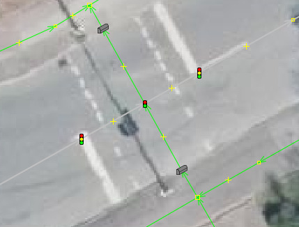

# wrong-pedestrian-lights (wpl)

Finds suspicious pedestrian signal setups in OSM PBF data and writes a
buffered bounding box around each one.

Pedestian signals mapped as `highway=crossing` `crossing=traffic_signals` has a very
different semantic than a `highway=traffic_signals`. The latter has typically a fixed
cycle so the delay is 1/2 of that cycle. In routing you would assume a delay of 30-45 seconds
for a node with `highway=traffic_signals` whereas you have a zero delay for the pure
pedestrian traffic_signals as these are typically push button operated.

The advantage in mapping the individual traffic_signals is a purely visual "mapping for the renderer"
and does not gain any functionality. Quite the opposite is true. The delay of the over mapping
pushes traffic of that road and onto road without pedestrian signals which means we are
pushing traffic from the higher class network of roads, into the residential areas where there
are no such pedestrian signals.

## Example

## What it finds

A car-drivable way with, in way order:

1. a node with `highway=traffic_signals`
2. exactly one node with `highway=crossing`, which must also carry
   `crossing=traffic_signals`
3. another node with `highway=traffic_signals`

Conditions:

- Way is `highway=` motorway, trunk, primary, secondary, tertiary,
  unclassified, residential, service, living_street, road or a `*_link`
  of the first five. Footways, cycleways, paths and tracks are ignored.
- Each outer signal is at most `-d` metres (default 30) from the crossing.
- No node from the first to the last signal is a junction. A junction is a
  node with more than two distinct neighbours on car ways. Split ways at
  a plain node do not count.
- The same triple is reported once.

Each hit is the bounding box of the three nodes plus a buffer (`-b`,
default 10 m).

## Build

Dependencies (Debian): `cmake`, `libosmium2-dev`, `libprotozero-dev`,
`libspatialite-dev`, `libsqlite3-dev`, `libbz2-dev`, `libexpat1-dev`,
`zlib1g-dev`, `pkgconf`.

    cmake -S . -B build && cmake --build build

Debian package (git-buildpackage):

    gbp buildpackage

## Usage

    wpl [-d meters] [-b meters] [-o out.geojson]
        [-s out.sqlite [-t table] [-g geomcol]] in.pbf

| Option | Meaning | Default |
|--------|---------|---------|
| `-d`   | Max distance signal to crossing (m) | 30 |
| `-b`   | Bounding box buffer (m) | 10 |
| `-o`   | GeoJSON output file | stdout, unless `-s` given |
| `-s`   | SpatiaLite output file (created if missing) | - |
| `-t`   | SpatiaLite table name | `crossings` |
| `-g`   | SpatiaLite geometry column | `geom` |

Examples:

    wpl -o hits.geojson region.pbf
    wpl -d 40 -b 15 -s hits.sqlite -t pedlights -g the_geom region.pbf

With `-s`, GeoJSON is only written if `-o` is given as well.
The SpatiaLite run fails if the table already exists.
Table and column names must match `[A-Za-z_][A-Za-z0-9_]*`.

## Output

Polygons in EPSG:4326 with these attributes:

| Attribute  | Meaning |
|------------|---------|
| `way`      | OSM way id |
| `signal_a` | node id of the first signal |
| `crossing` | node id of the crossing |
| `signal_b` | node id of the second signal |
| `dist_a_m` | distance signal_a to crossing (m) |
| `dist_b_m` | distance crossing to signal_b (m) |

The SpatiaLite table additionally has an autoincrement `id`.

## How it works

The input is read three times with libosmium:

1. Nodes: collect signals and crossings with their locations.
2. Ways: find candidate triples on car roads.
3. Ways: check the neighbours of all candidate nodes for junctions.

Memory use scales with the number of signals and crossings, not with the
size of the file.
